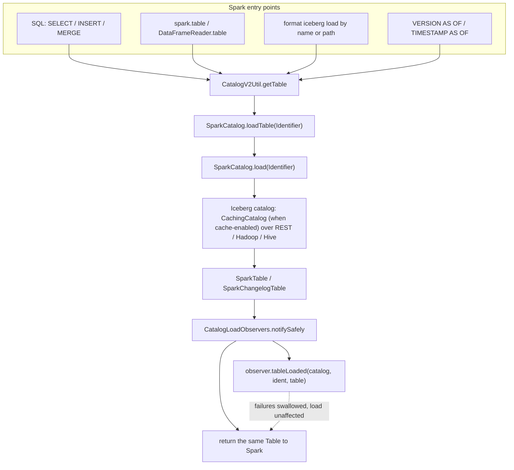
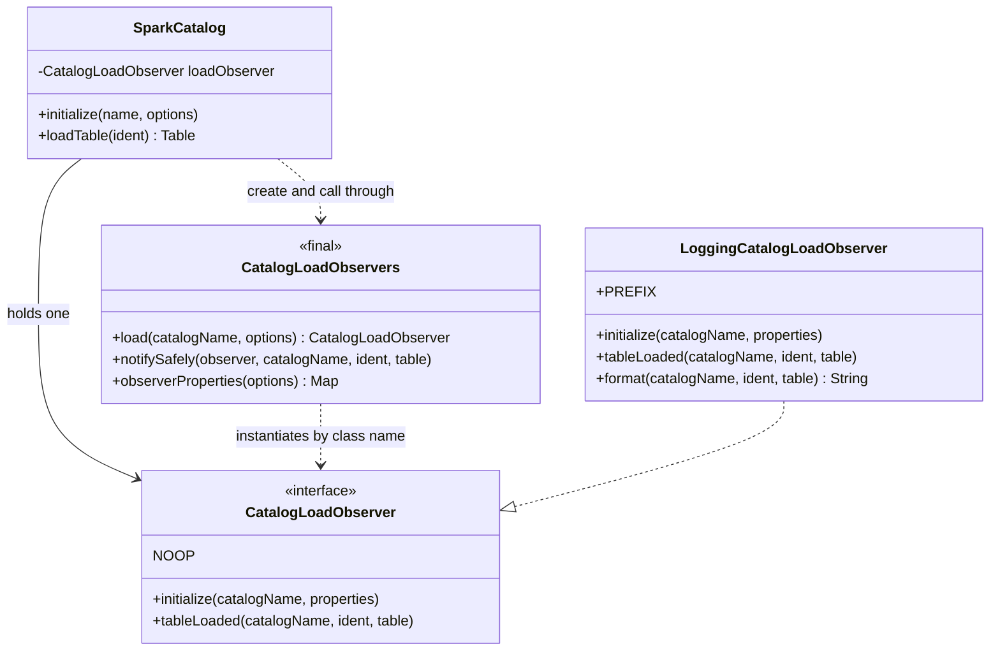
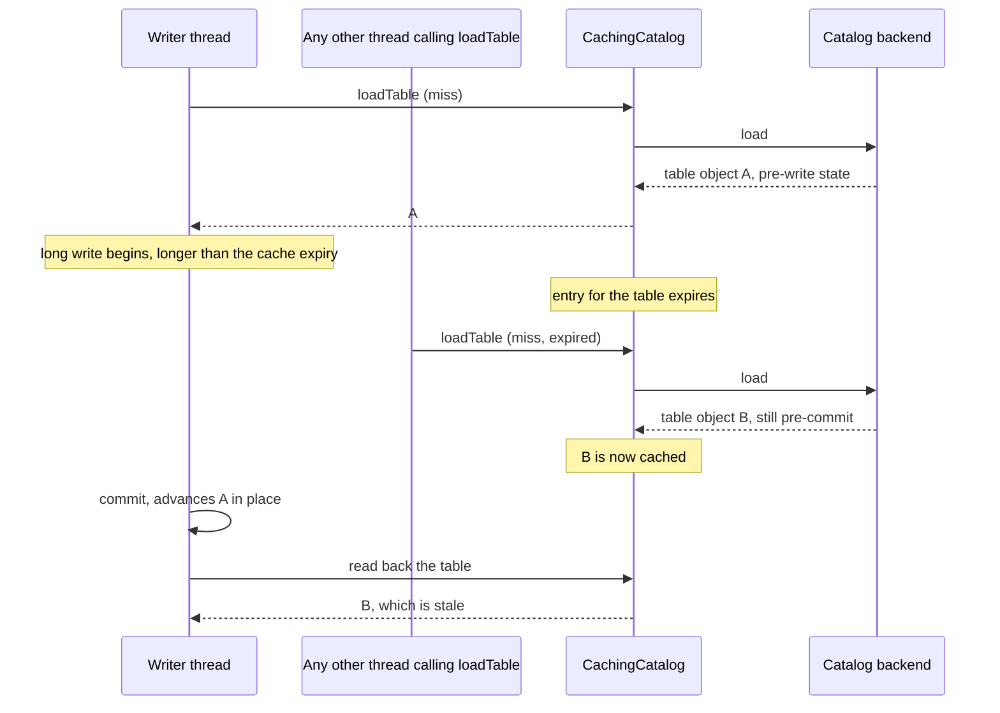
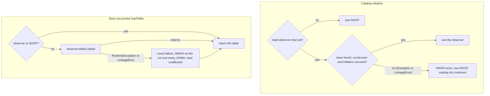

# Design: optional table-load observer for `SparkCatalog` (Spark 3.5 and 4.0)

Status: implemented in this change. Scope: `spark/v3.5` and `spark/v4.0` on the 1.10.1 patch line. The branch is upstream 1.10.1 plus this change only; no other fork patches are carried.

## 1. Summary

`SparkCatalog.loadTable(Identifier)` gets an optional, default-off hook. After a load succeeds, the
hook is called once with the Spark `Table` that is about to be returned. A built-in implementation
writes one log line per load. Operators can use that to see which tables a Spark application
resolves, from which thread, and (when the identifier selects one) at which snapshot or branch.

The hook is detection only. It cannot change what is loaded or returned, and it is built so that a
broken observer can never fail a query.

### Goals

- Know which tables a Spark application loads through an Iceberg catalog, regardless of how the
  code reads them (SQL, `spark.table`, `DataFrameReader`, `format("iceberg").load`, time travel,
  write targets).
- Zero behavior change when the property is not set.
- Never add a second catalog load, refresh or invalidation (see section 5).
- Keep the change small enough to carry between patch releases.

### Non-goals

- It does not block, rewrite or redirect a load.
- It does not tell reads from writes. A write target is also resolved through `loadTable`.
- It does not see reads that never go through this class (see section 8).
- It is not a metrics or lineage system. It is a hook plus a simple logging implementation.

## 2. Where the hook sits

Every Spark entry point that resolves an Iceberg table by name or path ends up in
`SparkCatalog.loadTable(Identifier)`. The hook is the last step of that method, after the table is
loaded, and it sits above the `CachingCatalog`, so cache hits are observed too.



Notes on the diagram:

- The time-travel overloads `loadTable(ident, version)` and `loadTable(ident, timestamp)` call
  `loadTable(ident)` first, so the hook fires once for them. The snapshot selected by
  `VERSION AS OF` / `TIMESTAMP AS OF` is applied after the hook, so the observer does not see it.
  A selector that is part of the identifier (for example a branch name) is visible in `ident`.
- Path identifiers go through the same method.
- `SparkSessionCatalog` delegates Iceberg tables to an inner `SparkCatalog`, and the catalog
  options reach it, so the hook works there too. Non-Iceberg tables handled by the session
  catalog's fallback are not observed.

## 3. Components



| Class | Role |
|---|---|
| `CatalogLoadObserver` | Public interface with the safety contract in its javadoc. Has a constant `NOOP`. |
| `CatalogLoadObservers` | Package-private. Creates the observer from catalog options and calls it without ever throwing. |
| `LoggingCatalogLoadObserver` | Built-in implementation. One INFO line per load, with a fixed prefix. |
| `SparkCatalog` | One field, one call at the end of `loadTable(Identifier)`, one call at the end of `initialize`. +10/-1 lines in each of `spark/v3.5` and `spark/v4.0`. |

## 4. Configuration

All keys are catalog properties, set as `spark.sql.catalog.<name>.<key>`.

| Key | Meaning | Default |
|---|---|---|
| `load-observer-impl` | Class name of a `CatalogLoadObserver` with a public no-arg constructor. Unset means no observer. | unset |
| `load-observer.<key>` | Passed to the observer's `initialize` with the `load-observer.` prefix stripped. No other catalog property is ever passed. | none |
| `load-observer.env-keys` | (built-in) comma-separated environment variable names to include in each line. Read once at `initialize`. | none |
| `load-observer.table-properties` | (built-in) comma-separated table property keys to include. Read from the loaded table's in-memory metadata. | none |
| `load-observer.dedup-window-ms` | (built-in) log a given catalog and identifier at most once per window. Bounded to 10,000 entries. | `0` (log every load) |

Log line format (fields in this order; bracketed fields are conditional):

```
iceberg-catalog-load catalog=<name> ident=<identifier> table=<table name>
  [snapshot-id=<id> | ref=<branch>] [prop.<key>=<value> ...]
  app-id=<application id> thread=<thread name> app-name=<application name> [env.<KEY>=<value> ...]
```

Values are written as-is, so an application name containing spaces produces a field with spaces.

## 5. Safety rules and why they exist

A caching catalog race (apache/iceberg#10493) shows what an observer must never become. A second
`loadTable` from another thread, while a long write is in flight, can refill the cache with a
pre-commit table, and a later read on the writing thread then returns stale data. The observer is
designed so that it can never be that second loader.



The observer adds none of the steps performed by the other thread in that diagram:

1. It runs after the real load returns and is handed that result. It does not call `loadTable`,
   `refresh` or `invalidateTable`. This is also the stated contract for custom implementations.
2. It reads table properties only from the `Table` object it was given. That is an in-memory read.
3. It is synchronous and does no I/O beyond one logger call. When INFO logging is disabled it
   returns immediately.
4. It runs on whichever thread called `loadTable`, including Spark listener threads. It is the
   caller's own load that is observed, not an extra one. The log line carries the thread name so
   loads from background threads can be told apart.

Failure isolation:



Other properties:

- A failed load (`NoSuchTableException`) is translated and thrown exactly as before. The observer
  is not called for it.
- The observer receives only `load-observer.*` catalog properties, so the REST endpoint,
  credentials, tokens and warehouse location never reach it.
- With `load-observer-impl` unset, the field holds the constant `NOOP` and the call returns on its
  first line.

## 6. Behavior worth knowing

- **Writes are observed.** `INSERT` and `MERGE` resolve their target through `loadTable`. A load is
  not necessarily a read.
- **Cache hits are observed.** The hook is above the cache.
- **Time travel.** `VERSION AS OF` / `TIMESTAMP AS OF` are applied after the hook (section 2).
- **Repeated resolution.** Spark can resolve a table more than once while planning one query. Use
  `dedup-window-ms` if one line per query is wanted.
- **Not observed:** the internal cache catalog used by maintenance actions
  (`SparkCachedTableCatalog`), direct calls on the underlying Iceberg catalog inside
  `SparkCatalog` (`alterTable`, `purgeTable`), and everything that does not use this class
  (other engines, the Iceberg APIs used directly).

## 7. Testing

| Test class | What it covers |
|---|---|
| `TestCatalogLoadObserver` | Run on the Hive, Hadoop, `spark_catalog` (`SparkSessionCatalog`) and REST test catalogs: one observation per SELECT on the calling thread, cache hit observed, `spark.table` / `read().table` / `format("iceberg").load` each once, `VERSION AS OF` / `TIMESTAMP AS OF` each once, write target observed, observer receives the same instance `loadTable` returns, missing table not observed and still throws, observer receives only its own prefixed properties. |
| `TestCatalogLoadObserverIsolation` | Observer that throws, throws `LinkageError`, fails in its constructor, fails in `initialize`, or names an unknown class: reads and writes keep working. No-op when unset. Credentials not passed. Cache hit observed. Log line format. |
| `TestCatalogLoadObserverStaleRead` | In-JVM regression for the pattern in section 5: caching on, short expiry, a write slowed past the expiry, and a background `loadTable` as a positive control. Asserts the stale read appears with the observer on and off (the observer does not hide it) and that it does not appear without the background load, with the observer on and off (the observer does not cause it). Timing-based. |

Result on a local run (JDK 17): 67 tests, 0 failures on each of `spark/v3.5` (Scala 2.12) and
`spark/v4.0` (Scala 2.13). The existing catalog tests in those modules pass.

## 8. Alternatives considered

| Alternative | Why not |
|---|---|
| A `SparkCatalog` subclass kept outside the fork | Needs every Spark configuration to name the subclass, and any application using the stock class bypasses it. |
| Iceberg's metrics reporter (`metrics-reporter-impl`, scan reports) | Fires once per planned scan, after planning, so it sees reads but not loads, and it cannot block or enrich the load. It is a good complement, not a replacement. |
| A Spark query-execution listener | Runs on listener threads and sees plans after the fact. A listener that calls back into the catalog is the shape that triggers the race in section 5. |
| Service-loader discovery of observers | Switches itself on whenever a jar is on the classpath. The explicit `load-observer-impl` property follows the existing `*-impl` convention and keeps the default off. |

## 9. Compatibility, rollout and rollback

- **Compatibility:** no existing property changes meaning, and no public method is removed or
  changed. With the property unset, behavior is identical to the unmodified class.
- **Rollout:** ship in a normal patch release, then enable on one catalog in a non-production
  environment, and confirm the log lines appear (one per load), that there are no new WARNs from
  `CatalogLoadObservers`, and that read results are unchanged.
- **Rollback:** unset `load-observer-impl`. No data or metadata format changes.

## 10. Porting notes

The hook point has the same shape in `spark/v3.5` and `spark/v4.0` at 1.10.1: the time-travel
overloads call `loadTable(ident)` first, so one call site covers them. In a Spark tree where the
time-travel overloads call `load(ident, TimeTravel)` directly instead, a port has to place the hook
at all three entry points, or wrap `load`.
